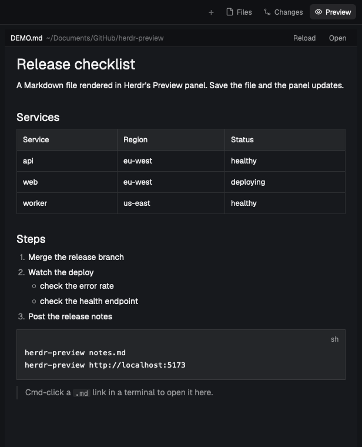
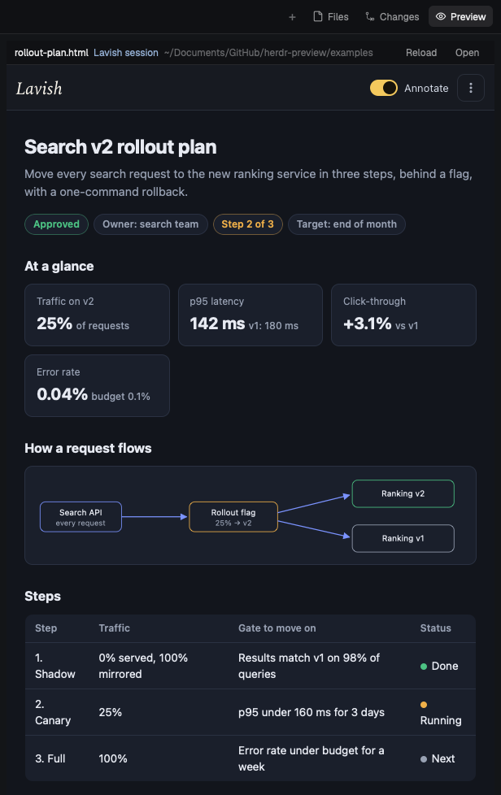

# herdr-preview

A Preview panel for the [Herdr](https://herdr.dev) app. It sits beside your terminals and shows
Markdown, HTML files and web pages:

- **Markdown** renders with Herdr's own renderer and updates every time the file is saved.
- **HTML files and web pages** (including `localhost` dev servers) show in a real WebKit view,
  with full CSS and JavaScript, smooth scrolling, clicks and typing.
- **A Preview button** next to Files and Changes opens and closes the panel.
- **Cmd-clicking a `.md` link** in a Herdr terminal (for example one a coding agent printed)
  opens it in the panel. Optional, on by default.

<table>
  <tr>
    <td valign="top"></td>
    <td valign="top"></td>
  </tr>
  <tr>
    <td>Markdown, rendered natively</td>
    <td>HTML in the WebKit view: a <a href="examples/rollout-plan.html">Lavish review doc</a>, with Lavish's annotation working</td>
  </tr>
</table>

## Platforms

| | macOS | Linux | Windows |
| --- | --- | --- | --- |
| Preview panel, Preview button, Markdown | Yes | Yes | Yes |
| HTML files | Real web view | Plain text (no CSS) | Plain text (no CSS) |
| Web pages and `localhost` | Yes | No (Open sends them to your browser) | No (Open sends them to your browser) |
| Cmd-click `.md` links into the panel | Yes | No | No |
| Installer | `install.sh` | `install.sh` | `install.ps1` |

The web view is a native macOS app that places its own window over the panel. Windows could get
one (WebView2); on Linux it could work on X11, but not on Wayland, where apps can't place windows
against another app's. **Linux and Windows are untested so far.** Reports welcome.

## Install

On macOS you need macOS 14 or later, the Herdr app, and the Xcode Command Line Tools
(`xcode-select --install`), which build two small helper apps on your Mac. On Linux you need the
Herdr app; the same script installs the panel, the layout and the command.

```sh
git clone https://github.com/TanviirDev/herdr-preview.git
cd herdr-preview
./install.sh
```

`install.sh` adds a new Herdr layout called `preview` and switches to it; your own layout
isn't changed, and Ctrl+Shift+L cycles back to it. It never overwrites a file it didn't install.
Options:

| Option | What it does |
| --- | --- |
| `--no-md-clicks` | Leave `.md` files alone, so Cmd-clicked `.md` links keep opening in their current app |
| `--no-switch` | Don't switch the Herdr window to the `preview` layout |
| `--update` | Replace the files from an earlier herdr-preview install |

To remove everything, run `./uninstall.sh`. It hands `.md` files back to their previous app.

On Windows, from the cloned folder in PowerShell:

```powershell
powershell -ExecutionPolicy Bypass -File .\install.ps1      # -Update, -NoSwitch as above
powershell -ExecutionPolicy Bypass -File .\uninstall.ps1
```

It installs the layout and mods into `~\.config\herdr-app` and `herdr-preview` (a `.cmd` with
its PowerShell script) into `~\.local\bin`; add that folder to your PATH.

Installing from [herdr.dev/layouts](https://herdr.dev/layouts) instead (asking your agent to
add it) copies only the layout and its two mods: Markdown works, but HTML falls back to plain
text, and there's no `herdr-preview` command or `.md` click routing. Run `install.sh` for those.

## Use

```sh
herdr-preview notes.md                 # show it in the Preview panel
herdr-preview report.html              # HTML: shown in the WebKit view
herdr-preview http://localhost:5173    # a web page or dev server
herdr-preview notes.md right           # a split pane beside the focused pane instead (or: down)
herdr-preview --snapshot page.png      # save what the web view shows now, e.g. for an agent to check
```

To try the web view, open the example: `herdr-preview examples/rollout-plan.html`.

`install.sh` also adds `mdp` as a short alias when nothing else on your Mac has that name.

In the panel's header: **Reload**, **Open** (Markdown goes to the app it opened in before, other
files to their default app), and for HTML files **Text/Web** to switch to the plain renderer.
Clicking a link to another `.md` or `.html` file opens it in the panel, with **←** to go back.

[Lavish](https://www.npmjs.com/package/lavish-axi) review docs: `herdr-preview doc.html` shows
the doc's open Lavish session when the Lavish server is running, so annotation and feedback work
in the panel. Start the session without a browser (`LAVISH_AXI_NO_OPEN=1 lavish-axi doc.html`),
then run `herdr-preview doc.html`.

## How it works

The Herdr app can't host a web view, so the HTML view is a separate, borderless window
(Herdr Preview Web) that floats exactly over the panel. The panel's mod writes where the panel
is to `~/.config/herdr-app/herdr-preview/panel.json` on every change and at least once a second.
The helper combines that with the Herdr window's position, follows it as you move or resize,
and hides whenever the panel is closed or that file goes stale. While Herdr is frontmost the
window floats above everything; while another app is, it sits just above Herdr's window, so
other apps cover it as they cover Herdr. The window never activates its app, so Herdr stays
frontmost while you click and type in a page.

Cmd-click routing works by making Herdr Preview Links the Mac's default app for `.md` files. A
file opened while Herdr is frontmost goes to the panel; one opened anywhere else goes to the app
that opened `.md` files before, which `install.sh` records. HTML files and web links are never
taken over: your default browser is untouched.

What gets installed:

| Path | What |
| --- | --- |
| `~/.config/herdr-app/layouts/preview.json` | the layout: Herdr's main layout plus the Preview panel |
| `~/.config/herdr-app/mods/preview/` | the panel |
| `~/.config/herdr-app/mods/preview-tabs/` | the tab bar with the Preview button |
| `~/.local/bin/herdr-preview` | the command |
| `~/Applications/Herdr Preview Web.app` | the WebKit view |
| `~/Applications/Herdr Preview Links.app` | `.md` click routing |

The panel mod runs programs (`open`, `sh`, `mkdir`) and writes outside its folder, to
`~/.config/herdr-app/herdr-preview/` and `~/.local/state/herdr-preview/`. Nothing is sent
anywhere: the only network traffic is the pages you open.

## Limits

- **Herdr's own menus and dialogs open underneath the web view** where they overlap the panel,
  for example the command palette. It's a separate window, so this can't be fixed from a mod.
- **The tab bar is a copy of Herdr's**, taken from Herdr app 0.1.15. It won't pick up Herdr's
  later changes to its tab bar; reinstall from a newer herdr-preview when one is out.
- **Tested on one Mac**: Herdr app 0.1.15, macOS 26, with the Herdr window on a 1x external
  display. Retina displays, moving the window between displays, full screen and Herdr zoom other
  than 100% are untested. Reports welcome.

## License

MIT, see [LICENSE](LICENSE). The `preview` layout and the `preview-tabs` mod are modified
copies of Herdr's `main` layout and `tabs` mod, which are Apache-2.0: see [NOTICE](NOTICE) and
[LICENSE-APACHE](LICENSE-APACHE).
