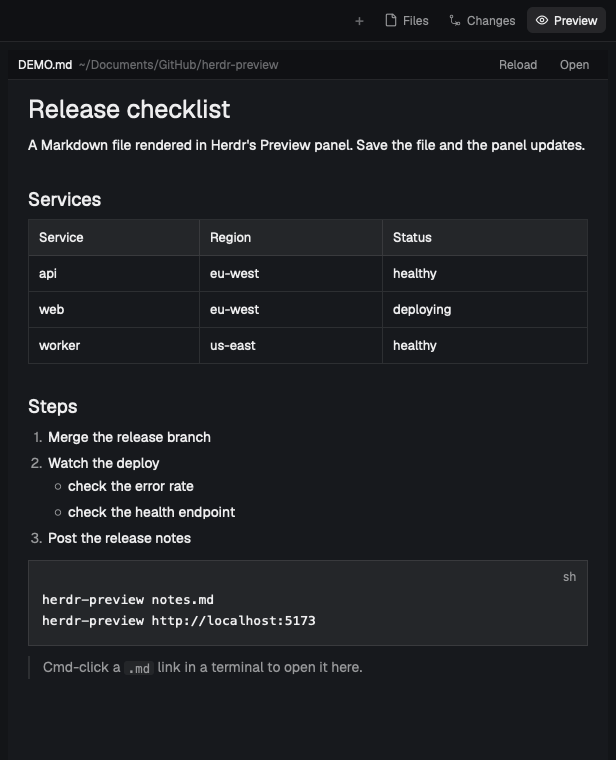

# Preview

Herdr's main layout with a Preview panel on the right, opened and closed by a Preview button
next to Files and Changes. The panel renders a Markdown file natively and re-renders it on every
save; with the companion helper app from the herdr-preview repository it also shows HTML files
and web pages in a real WebKit view.

## What you see

- Everything from Herdr's main layout, unchanged: the sidebar, the tab bar, the panes and the
  Files/Changes panel.
- **Tab bar, right end:** `+`, Files, Changes, then **Preview** (an eye icon). Highlighted,
  like Files and Changes, while its panel is open.
- **Preview panel:** a column between the panes and the Files/Changes panel, 600 px wide by
  default (320 to 1400, drag its edge), hidden until opened.
  - **Header, 30 px,** in the chrome colour with a bottom border, 12 px text: the file's name
    (semibold), a "Lavish session" tag when showing one, the folder (dim, truncated), then
    buttons: Text/Web (HTML files only), Reload, Open. A ← back button appears after following
    a link.
  - **Body:** the document. Markdown and plain-text HTML use Herdr's TextView at 14 px with
    20 px side padding, selectable and scrollable. In web mode the body shows "Opening the web
    view…" until the helper's window covers it.

## How it behaves

- **Preview button:** toggles the `preview-panel` column (`layout.toggle`). Independent of
  Files/Changes: both can be open at once.
- **What the panel shows:** whatever `~/.local/state/herdr-preview/target` names. Line 1 is a
  path or URL; line 2, optional, is a label for the header. The `herdr-preview` command writes
  it, then runs `layout.show {id: "preview-panel"}`. The mod watches that folder.
- **Markdown:** rendered with `TextView.markdown`, re-read when the file changes on disk.
- **HTML files and URLs:** shown in web mode when the helper app is installed: the mod starts
  it (`open -g -b io.github.tanviirdev.herdr-preview.web`) and writes the panel body's position to
  `~/.config/herdr-app/herdr-preview/panel.json`. Without the helper, or outside this layout,
  HTML falls back to `TextView.html` (no CSS, no scripts) and URLs show a note.
- **Links in a rendered document:** `.md`/`.html` targets open in the panel (← goes back); web
  links open in the default browser; other files open in their default app.
- **Open:** Markdown goes to the app recorded as the `.md` fallback in
  `~/.config/herdr-preview/settings.json` (so it doesn't loop back into the panel), anything
  else to its default app.
- **Split panes:** the same mod with `props: { file }` previews one file in a pane
  (`pane.split {direction, mod: "preview", props: {file}}`). Markdown and plain HTML only.
- Agent statuses don't affect this layout beyond Herdr's own mods.

## Built from

- **Layout:** Herdr's `main` layout (0.1.15) with two changes: the `tabs` block's mod is
  `preview-tabs`, and `work-body` gains, before `panel`, a node
  `{id: "preview-panel", type: "column", hidden: true, size: {px: 600}, min: 320, max: 1400}`
  holding one block `{id: "preview", content: {mod: "preview"}}`.
- **mods/preview:** the panel. Uses `props`, `layout`, `settings`, `appHome`, `theme`, `exec`,
  `readTextFile`, `watchFolder` from `herdr`, `fs/promises` for its state file, and
  `TextView`/`v_flex`/`h_flex` from `gpui-base`. Runs `open`, `sh` and `mkdir`. Writes outside
  its folder: `~/.config/herdr-app/herdr-preview/` and `~/.local/state/herdr-preview/`.
- **mods/preview-tabs:** a copy of Herdr's shipped `tabs` mod (0.1.15) with one added button that
  runs `layout.toggle {id: "preview-panel"}`. `preview.svg` is its icon; the `win-*.svg` icons
  come with the copy.
- **Outside Herdr (install.sh in the repository):** the `herdr-preview` command, Herdr Preview
  Web (a borderless, non-activating WebKit window placed over the panel body) and Herdr Preview
  Links (the `.md` default app that routes Cmd-clicks from Herdr to the panel).

## Watch out

- **Pane mods get their props from `props()`,** not from `init`'s argument, which can be empty.
- **The web view is measured from the window's right and top edges:** `work-body` padding, the
  Files/Changes panel's width plus `work-body`'s gap when it's shown, and the `tabs` block height
  plus padding plus the 30 px header. It needs nodes `preview-panel`, `panel`, `work-body` and
  `tabs`; without any of them the mod reports `visible: false` and stays in plain mode.
- **The geometry file is a heartbeat:** rewritten at least once a second, because a hidden
  copy's `render` doesn't run. The helper hides the view when the file is over 3 s old, so a
  layout switch or crash never leaves a stray window.
- **`exec` doesn't expand `~`:** the mod works out the home folder from `appHome()`.
- **Herdr reloads a mod the moment its files land,** and a reloaded panel starts the web view
  app at once. Install or rebuild the app before copying the mod. The mod also retries a missing
  app every 5 s, and re-launches a quit one every 5 s while a page is showing.
- **A plain `open` on a `.md` file loops** once the Links app is the `.md` default; the Open
  button uses the recorded fallback app.
- **Herdr's own menus and dialogs open under the web view.** It's another app's window.
- **The tab bar copy won't follow Herdr's updates** to its own tab bar.

## Done when

1. `herdr-app check` passes for `mods/preview` and `mods/preview-tabs`, and the `preview`
   layout shows with a Preview button beside Changes.
2. Preview opens and closes the panel; Files can be open at the same time.
3. `herdr-preview README.md` shows the README in the panel; saving the file updates the panel
   within about a second.
4. With the helper installed, `herdr-preview http://example.com` shows the styled page exactly
   over the panel body; it follows the window when moved or resized, follows the panel's edge,
   moves when Files opens, and disappears when another app is frontmost or Preview is clicked.
5. Without the helper, an `.html` file shows as plain text with "no CSS (web view not
   installed)" in the header.
